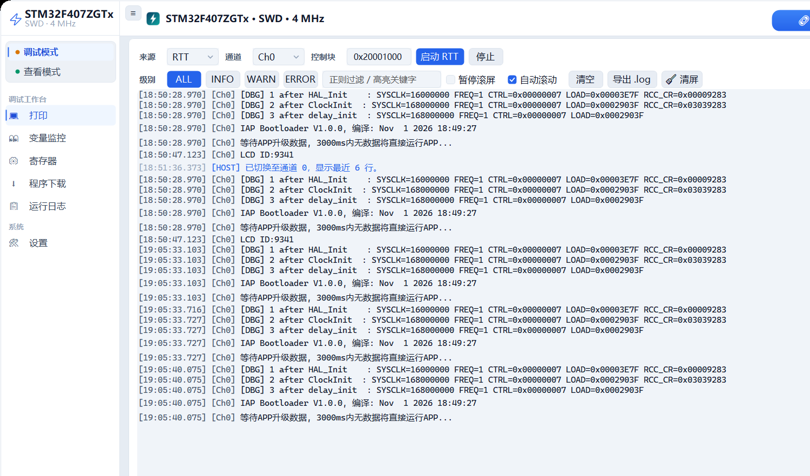

# JLink Studio Pro

Windows 上位机 + J-Link 在线调试工作台：设备连接、符号变量监控与波形、外设寄存器位域调试、RTT 日志终端、固件烧写、Keil 编译，并把整套能力通过本机 HTTP 网关开放给 AI / 脚本调用。



## 功能

| 页面 | 能做什么 |
|---|---|
| 设备与工程配置 | J-Link 连接（型号 / SWD-JTAG / 速率 / SN）、加载 ELF 符号表、加载 SVD 外设描述、连接与断开 |
| 变量监控 | 符号搜索与加入监控表、按类型格式化显示（Dec/Hex/Bin/Float/Ascii）、实时取值、多通道波形 |
| 时序采样 | 指定变量按间隔连续采样、统计并导出 CSV |
| 寄存器 | 外设 → 寄存器 → 位域三级浏览、按位域安全 Read-Modify-Write（受写保护策略约束） |
| HardFault 诊断 | 抓取核心寄存器 + 故障寄存器 + 最近日志，给出定位结论 |
| RTT 终端 | 实时日志、按通道/级别过滤、HEX 发送、快捷宏 |
| 程序下载 | `.bin/.hex/.elf` 烧写，走 J-Link 内置 Flash 算法（擦除 + 编程 + 校验），可烧后复位运行 |
| Keil 编译 | 调用 UV4 编译 / 重编译 / 编译并烧写，输出错误定位 |
| 运行日志 | 连接、烧写、脚本调用等会话记录，可被外部接口读取 |
| Skill 网关 | 本机 `127.0.0.1:5080` 提供 REST 接口，附带 Swagger 定义与操作审计 |

## 环境要求

- Windows 10/11 x64
- .NET 8 Desktop Runtime（自行构建时需要 .NET 8 SDK）
- SEGGER J-Link 软件 V7 及以上（提供 `JLink_x64.dll`；默认自动探测安装目录，也可用环境变量 `JLINK_STUDIO_DLL_DIR` 指定）

## 构建与运行

```powershell
git clone <repo-url>
cd JLink-Studio-Pro
dotnet build JLinkStudioPro.slnx
dotnet run --project src/JLinkStudio.WinFormsUI
```

发布单文件版本：

```powershell
dotnet publish src/JLinkStudio.WinFormsUI -c Release -r win-x64 --self-contained false -p:PublishSingleFile=true
```

产物在 `src/JLinkStudio.WinFormsUI/bin/Release/net8.0-windows/win-x64/publish/`，需要目标机器安装 .NET 8 Desktop Runtime。

## 对外接口（HTTP 网关）

应用启动后网关监听 `http://127.0.0.1:5080`（仅本机，无鉴权）。常用入口：

- `GET /api/v1/skill/manifest` — 能力清单与端点索引
- `GET /api/v1/session/status` — 连接与符号状态
- `POST /api/v1/flash/download` — 烧写固件
- `GET /api/v1/variables/history` — 取波形历史
- Swagger：`http://127.0.0.1:5080/swagger`

```powershell
Invoke-RestMethod http://127.0.0.1:5080/api/v1/session/status
Invoke-RestMethod -Method Post http://127.0.0.1:5080/api/v1/flash/download `
  -ContentType 'application/json' -Body '{"filePath":"D:\fw\app.hex","reset":true}'
```

安全限制由查看模式（`inspectMode`）与写保护策略（`writeEnabled` + 地址白名单）控制，所有写操作记入审计日志。完整说明见 [`skill/jlink-studio-pro/SKILL.md`](skill/jlink-studio-pro/SKILL.md)。

## 目录结构

```
src/JLinkStudio.Core/          J-Link 互操作、符号表、变量轮询、RTT、SVD、Keil 调用
src/JLinkStudio.SkillGateway/  ASP.NET Core 网关（Controllers / Models）
src/JLinkStudio.WinFormsUI/    界面（页面、控件、主题）
skill/jlink-studio-pro/        CodeBuddy skill：教 AI 使用上述接口
doc/                           详细设计文档与界面原型
```

## 已知限制

- 仅 Windows（WinForms + `JLink_x64.dll`）。
- 变量读写依赖 ELF 符号表；被编译器优化掉的变量读不到。
- 烧写依赖 J-Link 内置 Flash 算法，需要选择正确的芯片型号。

## 许可

未声明许可证前保留所有权利。
